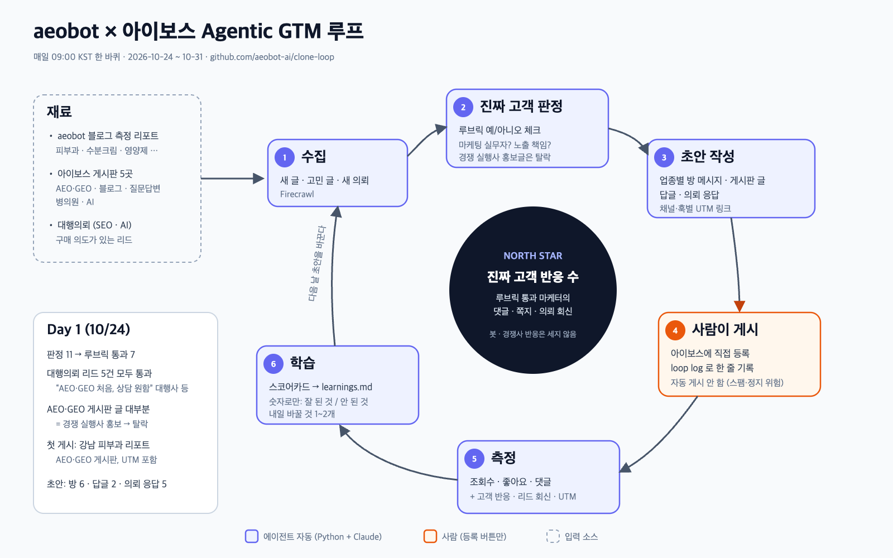

# clone-loop — aeobot 아이보스 GTM 루프

[aeobot](https://aeobot.ai)(AI 답변 엔진 속 브랜드 노출 측정)을 **진짜 고객**인 대기업 인하우스 마케터와 블로그 마케팅 대행사 담당자에게 알리는 Agentic GTM 루프입니다. Clone Loop Day Seoul(2026-10-24) 제출작.



## 왜 아이보스인가

국내 최대 마케터 커뮤니티 [아이보스](https://www.i-boss.co.kr)에는 우리 고객이 이미 모여 있고, 고민도 공개되어 있습니다.
- AEO·GEO 전용 게시판, 네이버 블로그 노출 변동 고민 글("블로그 노출 현황들 여쭙습니다" 조회 1,896·댓글 20)
- **대행의뢰 게시판**: "광고 대행사인데 AEO·GEO를 한 번도 관리해 본 적이 없어 상담을 원합니다" 같은 구매 의도 리드

## 루프 (하루 1회)

```
measure → collect → judge(루브릭) → scorecard → learn → drafts → (사람이 게시) → log ─┐
   ↑                                                                               │
   └──────────────────────────── 다음 날 ──────────────────────────────────────────┘
```

| 단계 | 하는 일 | 파일 |
|---|---|---|
| measure | 내가 올린 아이보스 글·답글의 조회수·좋아요·댓글을 다시 읽음 | `data/metrics.jsonl` |
| collect | aeobot 최신 블로그 글, 아이보스 5개 게시판의 관련 글, 대행의뢰(SEO·AI) 새 리드 | `out/<날짜>/threads.md`, `data/leads.csv` |
| judge | [`rubric.md`](rubric.md)의 예/아니오 체크리스트로 작성자가 진짜 고객인지 판정 | `data/targets.jsonl` |
| scorecard | North Star와 채널·훅별 성과, 리드 현황 | `out/<날짜>/scorecard.md` |
| learn | 스코어카드 숫자만 근거로 학습 노트 갱신 | [`learnings.md`](learnings.md) |
| drafts | 학습 노트를 반영한 오픈채팅방 메시지·게시판 글·답글·의뢰 응답 초안, 채널·훅별 UTM 링크 | `out/<날짜>/drafts.md` |

**North Star:** 루브릭을 통과한 마케터에게서 받은 반응 수(댓글·쪽지·의뢰 회신). 봇이나 엉뚱한 사람에게 닿은 숫자는 세지 않습니다.

## 사람이 하는 일 (하루 5~10분)

아이보스에는 게시 API가 없고, 자동 게시는 스팸·계정 정지 위험이 있어 **등록 버튼만 사람이 누릅니다.**

1. `out/<오늘>/drafts.md`를 읽고 고쳐서 올립니다.
2. 올린 것과 받은 반응을 한 줄씩 기록합니다.

```sh
uv run python -m loop log --channel board-aeo --kind reply --url https://www.i-boss.co.kr/ab-6141-72783 --hook h-winter-moisturizer-ai-1 --campaign winter-moisturizer-ai
uv run python -m loop log --channel room-beauty --kind chat --hook h-winter-moisturizer-ai-1 --campaign winter-moisturizer-ai
uv run python -m loop log --channel lead --kind response --note "대행사 AEO 의뢰자 회신, 미팅 잡음"
```

## 실행

```sh
uv sync
echo "FIRECRAWL_API_KEY=..." > .env
uv run python -m loop run      # 하루 한 바퀴
uv run pytest                  # 테스트
```

LLM 단계는 headless Claude Code(`claude -p`)를 씁니다. 매일 09:00 KST 자동 실행:

```cron
0 9 * * * /path/to/clone-loop/scripts/daily.sh >> /tmp/clone-loop.log 2>&1
```

## 하지 않는 것

- 아이보스·카카오 오픈채팅 자동 게시
- 블로그에 없는 수치, "노출 보장" 같은 표현
- 새 계정 첫 3일(~10/26)의 홍보 글: 답글과 정보 공유로 신뢰를 먼저 쌓습니다

## 7일 뒤 보고할 숫자 (2026-10-31)

- North Star: 진짜 고객 반응 수, Day 1 → Day 7
- 루브릭 통과 대상 수와 통과율
- 채널·훅별 조회·댓글 변화, 대행의뢰 리드 수·응답 수·회신 수
- `learnings.md` git 이력: 루프가 바꾼 결정들
